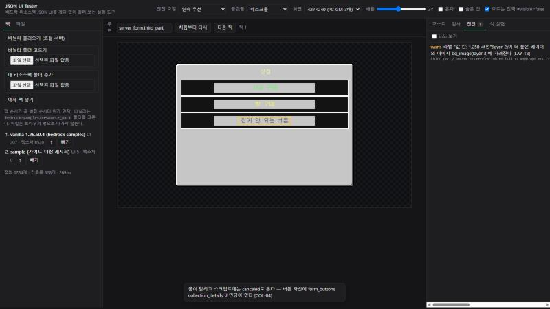
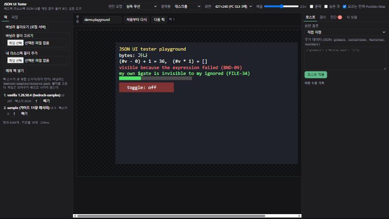

# JSON UI Tester

배드락 리소스팩 JSON UI를 게임 없이 돌려 보는 실험 도구다. 이 저장소의 엔진 근거(가이드 규칙, 네이티브 바이너리 분석 `NB`, Cinnabar 재구성 `CN`)를 JavaScript로 다시 구현했다. 브라우저 GUI와 명령줄(`cli.mjs`) 두 가지로 쓴다.

> 작성 2026-10-23. 바닐라 기준 v1.26.50.4(`bedrock-samples` `46ba6ea`). **이 도구의 결과는 게임 동작이 아니다.** 엔진 규칙을 문서에서 옮긴 모델이라, 규칙이 틀렸거나 아직 모르는 곳에서는 게임과 다르다. 최종 확인은 게임에서 한다.

## 1. 가능성 판단: 만들 수 있다

결론부터 적는다. **JSON UI 테스터는 만들 수 있고, 이 폴더에 동작하는 시제품이 있다.** 근거:

| 확인한 것 | 결과 |
| --- | --- |
| 식 평가기 | Cinnabar 평가기 실행 결과(`cinnabar/samples/평가기-실행-결과.md`) 42건을 그대로 테스트로 삼아 **모두 같은 값**을 낸다. 바이트 자르기, 사슬 비교, `* 1`이 빈 문자열이 되는 것, `0.3`이 정수 0인 것, `%`·`>=`가 null이 되는 것 포함 |
| 크기 식 | Cinnabar 크기 식 결과 16건과 같다(`"100c%"`가 부모 %, `"10"`이 0, `50%cm`이 최대 자식 등) |
| 바닐라 전체 로드 | 바닐라 `ui/` 207개 파일, 정의 6,276개를 0.3초에 읽는다 |
| 바닐라 화면 해석 | `server_form.third_party_server_screen`(107개 컨트롤), `hud.hud_screen`(748개), `chest.small_chest_screen`(223개)을 **해석 오류 0건**으로 만든다 |
| 서버 폼 흉내 | 바닐라 액션 폼에 제목·본문·버튼을 주면 바닐라 레이아웃 그대로 제목, 본문, 버튼 글자가 제자리에 놓인다(창 225×200이 화면 가운데) |
| 버튼 누름 | 버튼 자신에 `collection_details`가 있으면 "selection = N", 없으면 "canceled"(COL-04)로 답한다 |
| 시간 흐름 | `once`, `visibility_changed`를 틱 단위로 흉내 내 preserved title 래치가 동작한다 |
| 가이드 레시피 실행 | 가이드 11장 레시피 1·2(게임에서 다시 실행해 보지 않았다고 적힌 코드)를 바닐라 위에서 돌렸다. 아래 3절의 발견이 나왔다 |





할 수 없는 것도 분명하다(4절). 요약하면 **"구조·바인딩·식·레이아웃이 맞는지"는 꽤 믿을 만하게 보고, "픽셀이 게임과 똑같은지"와 "엔진만 아는 값"은 보지 못한다.**

## 2. 쓰는 법

### 2.1 GUI

```bash
node jsonui-tester/serve.mjs
```

브라우저에서 `http://localhost:5178`을 연다. 서버는 `../../bedrock-samples/resource_pack`(이 저장소 옆의 바닐라 사본)을 찾아 자동으로 불러온다. 다른 위치면 `VANILLA=<resource_pack 경로>`를 준다.

정적 호스팅(GitHub Pages 등)에서는 바닐라 v1.26.50.4를 GitHub(`Mojang/bedrock-samples` 커밋 `46ba6ea`)에서 직접 받는다. UI 파일 207개를 처음에 받고, 텍스처는 화면에 쓸 때 받는다. 로컬에서 같은 상태를 보려면 `node serve.mjs 5179 --no-vanilla`. "바닐라 폴더 고르기"로 내려받은 `resource_pack` 폴더를 써도 된다. 내 리소스팩 파일은 브라우저 밖으로 나가지 않는다.

배포: `.github/workflows/jsonui-tester.yml`이 `main`에 올 때마다 테스트를 돌리고, 저장소가 공개일 때만 이 폴더(GUI 파일만)를 GitHub Pages로 올린다. 무료 요금제는 비공개 저장소에서 Pages를 쓸 수 없다.

| 영역 | 하는 일 |
| --- | --- |
| 위 막대 | 엔진 모델(실측 우선 / CN 그대로), 플랫폼 변수(데스크톱 / 휴대폰), 화면 크기, 배율, 윤곽·숨은 컨트롤 보기, "모르는 전역 `#visible`을 false로" |
| 왼쪽 "팩" | 바닐라, 내 리소스팩 폴더, 예제 팩을 넣고 순서를 바꾼다(위가 먼저 병합) |
| 왼쪽 "파일" | 읽은 UI 파일을 고쳐 바로 적용한다(Ctrl+Enter) |
| 가운데 | 화면. 컨트롤을 누르면 고르고, 버튼·토글이면 엔진의 응답을 흉내 낸다. 마우스를 올리면 호버 상태가 된다 |
| "처음부터 다시" / "다음 틱" | 트리를 새로 만든다 / 컨트롤 상태를 유지한 채 호스트 데이터를 다시 보낸다(`once`, `visibility_changed` 시험) |
| 오른쪽 "호스트" | 화면에 줄 데이터: 서버 폼(제목, 본문, 버튼), HUD(타이틀, 부제, 액션바), 상자(이름, 칸), 직접 JSON |
| 오른쪽 "검사" | 컨트롤 트리, 고른 컨트롤의 정의 사슬, 사각형, 레이어, 속성 주머니, 바인딩, `$` 변수, 해석된 속성, 진단 |
| 오른쪽 "진단" | 엔진 오류 문구(NB에서 가져옴)와 가이드 규칙 ID가 붙은 경고. 누르면 그 컨트롤로 간다 |
| 오른쪽 "식 실험" | 식과 속성 주머니를 넣으면 값과 함정(없는 연산자 등)을 바로 보여 준다 |

### 2.2 명령줄

```bash
node jsonui-tester/cli.mjs --vanilla ../bedrock-samples/resource_pack --pack ./my_rp --root server_form.third_party_server_screen --title "myui:v1 상점" --buttons "사과;빵"
```

진단과 보이는 라벨(글자, 위치)을 찍고, `error` 진단이 있으면 종료 코드 1을 낸다. `--json`이면 JSON으로, `--cn`이면 CN 모델로, `--host hud --hud-title T --actionbar A`면 HUD로 돈다. AI 에이전트나 CI가 리소스팩을 고친 뒤 정적 시뮬레이션으로 쓸 수 있다.

### 2.3 테스트

```bash
cd jsonui-tester && npm test
```

80건(식 50, 크기·JSON 21, 정의 해석 8, 래치 1). 외부 패키지 없이 Node 20+의 `node:test`로 돈다.

## 3. 시제품으로 찾은 것

| 발견 | 내용 | 근거 |
| --- | --- | --- |
| 가이드 레시피 1의 라벨이 배경 뒤로 갈 수 있다 | 레시피의 `bg@common.common_panel`은 안쪽 `bg_image`가 `layer: 1`이다. layer를 주지 않은 형제 라벨(layer 0)은 그 아래에 그려진다. 예제 팩에서는 제목에 `layer: 2`를 주어 고쳤고, 값 칸은 그대로 두어 진단이 뜨는 것을 보인다 | LAY-18, 바닐라 `ui_common.json` `common_panel`. **게임 확인 필요** |
| 식 안의 `$변수` 치환이 근거끼리 갈린다 | 가이드 BND-33(드래곤팩토리 실측)은 식 일부로 끼운 `$변수`가 치환되지 않았다고 한다. 디스코드의 preserved title 패턴(`(#text - $update_string)`)은 *confirmed*로 동작한다고 한다. 테스터는 두 모델을 다 돌릴 수 있고, 실측 우선 모드에서 이 경우 경고를 낸다 | BND-33, 종합-가이드 10.3절. **게임 확인 필요** |
| `modifications`의 MOD-04 경고는 기반을 끝까지 봐야 한다 | `long_form`의 `bindings`에 넣는 것은 기반(`common_dialogs.main_panel_no_buttons`)에 `bindings`가 없어서 안전하다. 처음 만든 경고가 이를 틀리게 잡아, 모든 파일을 읽은 뒤 기반 사슬을 확인하게 고쳤다 | MOD-04, 가이드 11장 주의 |
| 바닐라 화면 대부분의 숨김은 엔진만 아는 전역값이다 | HUD에는 엔진 컨트롤러가 답하는 `#visible` 플래그(대화상자, 번들 툴팁 등)가 많다. 흉내 데이터에 없으면 기본값 true라 전부 보인다. "모르는 전역 `#visible`을 false로" 옵션(기본 켬)으로 맞췄고, 검사 탭에 가정했다고 적는다 | BND-09, CN-36 |

## 4. 한계

- **게임이 아니다.** 근거가 `코드`인 규칙(NB, CN)은 그대로, `실측`과 다른 곳은 "실측 우선" 모드에서 실측을 따른다(BND-05 배열 전체 버림, MOD-02 다른 경로 무시, EXP-10 리터럴 자르기 없음, BND-33). 둘 다 틀릴 수 있다.
- **엔진 데이터는 흉내다.** 화면 컨트롤러가 주는 바인딩은 `src/engine/host.js`의 일부만 있다. 모르는 전역값은 없음(또는 `#visible` false)으로 본다. 아이템 렌더러, 종이 인형, 스크롤 동작, 애니메이션, 입력 포커스, 소리는 그리지 않거나 자리표시만 한다.
- **글자 폭은 근사다.** 기본 글꼴을 ASCII 6px, 넓은 글자 9px, 줄 10px로 잰다. `%c`로 글자에 맞춘 레이아웃은 몇 픽셀 다를 수 있다. 현지화는 하지 않는다(lang 키는 점선 밑줄로 표시).
- **텍스처**: PNG·JPG만 그린다(TGA 없음). 9-slice는 CSS `border-image`, 틴트는 곱하기 혼합이라 게임 색과 조금 다르다.
- **크래시는 흉내 내지 않는다.** 크기 바인딩에 숫자가 아닌 값, 문자열 나누기처럼 게임을 죽이는 식은 진단으로만 알린다.
- **버전**: 바닐라 1.26.50.4 구조 기준이다. 다른 버전의 바닐라를 넣으면 그 구조로 돈다.

## 5. 구조

| 파일 | 하는 일 | 근거 규칙 |
| --- | --- | --- |
| `src/engine/expr.js` | 토큰, 우선순위, 타입별 연산, 결과 재해석, 사전 조회, 함정 검사 | EXP-*, CN-26~30 |
| `src/engine/jsonc.js` | jsoncpp 규칙(주석 허용, 뒤따르는 쉼표·따옴표 없는 키는 오류, 오류 앞까지 로드) | FILE-30, CN-01~02 |
| `src/engine/size.js` | 크기 식 | LAY-03, LAY-34~37, CN-47 |
| `src/engine/catalog.js` | `_ui_defs` 정렬 로드, 같은 경로 병합, 경로 키, `modifications` 11개 연산 | FILE-20~22, MOD-*, CN-03~13, NB-01~03 |
| `src/engine/resolve.js` | `@` 상속, `$` 스코프(확정값 우선), `variables`, `ignored`(부모 스코프, 가장 먼저) | FILE-*, CN-14~25, NB-10 |
| `src/engine/bind.js` | 속성 주머니, 팩토리·그리드·컬렉션, global/collection/view 바인딩, `binding_condition` 틱, 버튼·토글 상태, 누름 흉내 | BND-*, COL-*, INP-*, CN-31~46, NB-04~09 |
| `src/engine/layout.js` | 크기, 앵커, 스택(숨은 자식 공간 없음), 그리드, 레이어, 클리핑, 가려짐 검사 | LAY-*, CN-48~50 |
| `src/engine/host.js` | 서버 폼, HUD, 상자 화면 흉내 데이터 | 10장, CN-59~60 |
| `src/render.js`, `src/app.js`, `index.html` | 브라우저 GUI | — |
| `samples/sample-pack.js` | 예제 팩: 가이드 11장 레시피 1·2, preserved title, 바닐라 없이 도는 놀이터(`demo.playground`) | PAT-01~02, BND-18 |
| `cli.mjs`, `serve.mjs` | 명령줄, 로컬 서버 | — |

## 6. 다음에 할 만한 것

- 게임 확인 항목(3절)을 실제 게임으로 재서 결과를 모드 규칙에 반영한다.
- 엔진 컨트롤러가 주는 전역 바인딩 목록을 화면별로 모은다(바이너리 문자열 또는 바닐라 바인딩 이름 전수).
- 글꼴 메트릭을 바닐라 `font/` 글리프 폭으로 바꾼다.
- 애니메이션(`anims`)의 오프셋·알파·플립북을 시간 축으로 재생한다.
