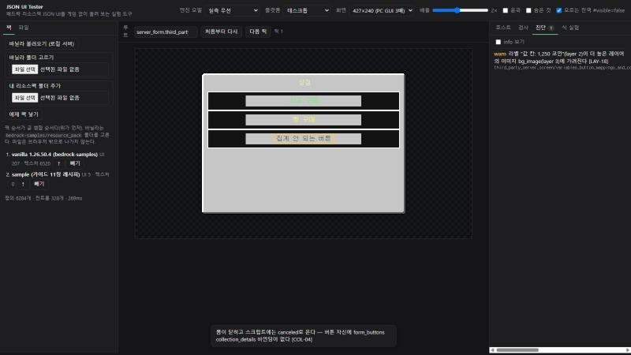

# MCBE JSON UI Tester

English | [한국어](./README.ko.md)

An experimental tool that runs Minecraft Bedrock Edition resource pack JSON UI (`ui/*.json`) without the game. It stacks your resource pack on the vanilla UI, draws the screen, evaluates bindings and expressions, and reports engine error messages and common traps as diagnostics. It has a browser GUI and a command line (`cli.mjs`).

**Try it: <https://presentkim.github.io/mcbe-json-ui-tester/>**

> Vanilla baseline v1.26.50.4 (`Mojang/bedrock-samples` commit `46ba6ea`). **The results are not game behavior.** The engine rules come from documentation, decompiled client code and in-game measurements, so the tool differs from the game wherever a rule is wrong or still unknown. Check the final result in the game.



## 1. What it does

| Feature | Details |
| --- | --- |
| Your pack over vanilla | Reads the 207 vanilla `ui/` files (about 6,300 definitions) and merges your packs in pack order. Handles the 11 `modifications` operations, same-path merging and path keys (`"a/b/c"`) |
| Screens | Builds vanilla screens such as server forms (action and modal), the HUD and the chest screen and draws them with vanilla textures on one canvas |
| Mock data | Feeds form titles, bodies and buttons, HUD titles and actionbars, and chest slots in place of the screen controller |
| Button presses | Simulates the engine's answer: "selection = N" when the button has its own `collection_details`, otherwise "canceled". Follows the client rules for button and toggle states, hover, `consume_hover_events` and `button_mappings` |
| Time | "Next tick" sends the data again while keeping control state, to test `once` and `visibility_changed`. "Play animations" runs animations in real time with the client's 32 easing functions, `next` chaining and button events |
| Scrolling | Scroll views move with the mouse wheel; the scrollbar box length follows the client formula |
| Localization | Label text is translated with the vanilla and pack `texts/<language>.lang` files |
| Diagnostics | Engine error messages (`Must define a source property name in the binding!`, `Type '...' not recognized for control`, `Unrecognized renderer`, ...) and warnings tagged with rule IDs: missing operators, `* 1` number conversion, dividing a string by a number (freezes Windows 1.26.65), unset variables in `requires` (froze the game), labels covered by higher layers, and more |
| Inspect | Control tree, definition chain, rect, layer, property bag, bindings, `$` variables |
| Expressions | Type an expression and a property bag to see the value and its traps |
| Item icons | Draws `#item_id_aux` (numeric ID × 65536 + data) of `inventory_item_renderer` and chest slots as vanilla item icons, blocks as isometric cubes |

Checks: the expression evaluator agrees with all 42 results of the Cinnabar evaluator and the client rules measured on Windows 1.26.65.1; size expressions agree in 18 cases. Real server packs (13 form layouts, a 93 button split screen, a chest machine window, a HUD sidebar, 5 stacked resource packs) run without resolve errors. There are 206 tests.

## 2. Usage

### 2.1 On the web

Open <https://presentkim.github.io/mcbe-json-ui-tester/>. Vanilla UI comes from `Mojang/bedrock-samples` on GitHub (207 UI files first, textures when used). "Add my resource pack folder" picks your pack root (the folder with `ui/` and `textures/`). Your pack files never leave the browser.

| Area | Purpose |
| --- | --- |
| Top bar | UI language (English by default, Korean available, saved in the browser), engine model (measured first / CN as is), platform variables (desktop / phone), game language (English by default), screen size, zoom, outlines, hidden controls, "unknown global `#visible` = false" |
| Left "Packs" | Add vanilla, your pack folders and the sample pack and reorder them (top merges first) |
| Left "Files" | Edit a loaded UI file and apply it (Ctrl+Enter) |
| Center | The screen. Click to pick a control; buttons and toggles answer like the engine. Hover sets the hover state |
| "Start over" / "Next tick" / "Play animations" | Rebuild the tree / send the host data again / run animation time |
| Right "Host" | Data for the screen: server form, HUD, chest, or raw JSON (`globals`, `collections`, `factories`, `hostVars`) |
| Right "Inspect", "Diagnostics", "Expressions" | See section 1 |

Two engine models:

- **Measured first** (default): where an in-game measurement differs from code or reconstruction, follow the measurement.
- **CN as is**: follow the rules of the Cinnabar reconstruction and the client code.

### 2.2 Locally

```bash
git clone https://github.com/PresentKim/mcbe-json-ui-tester
cd mcbe-json-ui-tester
node serve.mjs            # http://localhost:5178
```

To open your packs without picking folders, pass them with `--pack`, bottom pack first (later packs win).

```bash
node serve.mjs 5180 --pack ../packs/theme --pack ../packs/server
```

A saved test opens from the address: `?scenario=<JSON URL>` loads `{ root, host, screen: {w, h}, zoom, mode, platform, language, items }`, and `&view=stage` draws only the screen at the top left for pixel comparison with game screenshots. `--static <folder>` serves that folder at `/static/`.

```bash
node serve.mjs 5181 --static ./scenarios
# http://localhost:5181/?scenario=/static/research.json&view=stage
```

A 1920×1009 game window at GUI scale 4 is a 480×253 screen (the game rounds the window size divided by the scale up).

`items` mocks the item list a server sends: `{ "<numeric ID>": { name, block?: { textures: { up, west, south, "*", <material instance> … }, geometry? } } }`. Icons and models are looked up in the loaded packs' `item_texture.json`, `terrain_texture.json` and `models/`.

`serve.mjs` finds `bedrock-samples/resource_pack` next to the repository (`../bedrock-samples` or `../../bedrock-samples`) and loads vanilla from it. Set `VANILLA=<resource_pack path>` for another place. Without it, vanilla comes from GitHub as on the web (`node serve.mjs 5179 --no-vanilla` shows that state). No packages are needed (Node 20+).

### 2.3 Command line

```bash
node cli.mjs --vanilla ../bedrock-samples/resource_pack --pack ./my_rp --root server_form.third_party_server_screen --title "myui:v1 Shop" --buttons "Apple;Bread"
```

Prints the diagnostics and the visible labels (text and position) and exits with 1 when there is an `error` diagnostic. `--json` prints JSON, `--cn` uses the CN model, `--host hud --hud-title T --actionbar A` runs the HUD, `--sample` adds the built-in sample pack, `--language ko_KR` picks the game language and `--ui-lang ko` prints Korean messages. It works as a static check for AI agents or CI after editing a pack.

### 2.4 Tests

```bash
npm test
```

206 tests on `node:test`. Rules read from the client code are in the `engine-code`, `layout-code`, `controls`, `anim`, `text`, `input`, `render-rules` and `lang` tests; `i18n` checks that every page and diagnostic message has a Korean translation.

## 3. Rule IDs and sources

IDs such as `[EXP-16]` and `[COL-04]` in diagnostics are rule numbers of the author's Korean JSON UI guide (a private research repository). Chapters: `FILE` files and definitions, `MOD` modifying vanilla screens, `LAY` layout, `BND` bindings, `EXP` expressions, `COL` collections and factories, `INP` input, buttons and toggles, `TXT` text, `ANI` images and animation, `HOST` screen hosts, `PAT` patterns, `DBG` debugging. The sources are:

| Short | Source |
| --- | --- |
| Measured | In-game measurements (bedrock-core author's, the author's server and Windows 1.26.65.1 measurements) |
| Vanilla | Full search of the vanilla resource pack v1.26.50.4 `ui/` |
| `CN` | The JSON UI reconstruction in Cinnabar (`cinnabar-mc/cinnabar`) and its evaluator results. No Cinnabar code is included; only the behavior rules are reimplemented |
| Client code | Expression evaluator, bindings, layout, control types, animation, text, input and image drawing rules read from the decompiled Android 1.26.52.3 and Windows 1.26.65.1 clients |
| Community | Bedrock Wiki, Bedrock OSS and Bedrock Add-Ons Discord servers |

## 4. Limits

- **It is not the game.** Both engine models can be wrong. Where sources disagree, the diagnostic says that a game check is needed.
- **Engine renderers**: besides item icons and `gradient_renderer`, engine renderers (`live_player_renderer`, `paper_doll_renderer`, ...) are placeholders, shown with "Outlines". Known in-game results about them are reported as diagnostics.
- **Engine data is mocked.** Only part of the screen controller bindings exist in `src/engine/host.js`; unknown globals are absent (or `#visible` false). Arrow keys move focus and Enter sends `button.menu_ok` by the client's focus rules, and controls outside the highest-layer `modal` get no input; the gamepad cursor, `focus_magnet_enabled`, the `custom` navigation mode, screen stacks and sounds are not simulated. Overlays that depend on engine globals such as `#using_touch` may show in the chest screen. The distance of one wheel notch was not measured.
- **Animation** follows the client code; `aseprite_flip_book`, the first frame fast-forward and screen entrance events are missing.
- **Text**: line breaks and widths use the game font's advance table (`data/font-metrics.json`). Glyph shapes come from the browser font. `font_size` is 0.5, 1, 2 and 4 times for `small`, `normal`, `large` and `extra_large`; `medium` is `normal` (measured).
- **Textures**: PNG and JPG only. The client tries `.tga` first, so a TGA-only texture is not drawn; a PNG or JPG next to it is drawn instead.
- **Crashes and freezes are not simulated**; they are reported as diagnostics.
- **Version**: based on vanilla 1.26.50.4. Another vanilla folder runs with its structure.

## 5. Layout of the code

| File | Purpose |
| --- | --- |
| `src/engine/expr.js` | Tokens, precedence, typed operators, result reinterpretation, traps |
| `src/engine/jsonc.js` | jsoncpp rules (comments allowed, trailing commas and unquoted keys are errors, members before an error are kept) |
| `src/engine/size.js` | Size expressions |
| `src/engine/catalog.js` | Sorted `_ui_defs` loading, same-path merging, path keys, the 11 `modifications` operations |
| `src/engine/resolve.js` | `@` inheritance, `$` scopes, `variables`, `ignored`, control type and renderer checks |
| `src/engine/bind.js` | Property bags, factories, grids, collections, global/collection/view bindings, `binding_condition`, button and toggle states, presses |
| `src/engine/anim.js` | Animation definitions, easing, per-control progress, button events, `next`, `destroy_at_end` |
| `src/engine/layout.js` | Sizes, anchors, stack panels, grids, layers, clipping, scrolling, layout diagnostics |
| `src/engine/host.js` | Mock data for server forms, the HUD and the chest screen |
| `src/engine/lang.js` | `.lang` files and label localization |
| `src/render.js`, `src/app.js`, `index.html`, `app.css` | Browser GUI (canvas renderer with a DOM overlay for inspection) |
| `src/i18n.js`, `src/locales/ko.js` | Page and diagnostic messages; English text is the key, Korean is a catalog |
| `samples/sample-pack.js` | Sample pack: custom action form, preserved title, a playground that runs without vanilla (`demo.playground`) |
| `data/item-atlas.json`, `tools/build-item-atlas.mjs` | Numeric item ID to icon texture table and the script that builds it from vanilla samples |
| `src/engine/font.js`, `data/font-metrics.json`, `tools/build-font-metrics.mjs` | Text widths and line breaks from the installed game's font advances (no glyph images are included) |
| `src/engine/geometry.js` | Block models (geo.json) to icon faces |
| `cli.mjs`, `serve.mjs` | Command line and local server |
| `.github/workflows/pages.yml` | Tests and GitHub Pages deploy on every push to `main` |

## 6. Vanilla files

This repository contains no vanilla files. The web version downloads them from `Mojang/bedrock-samples` at run time, and locally the tool reads your own copy. Screenshots in `docs/` show vanilla UI textures.
